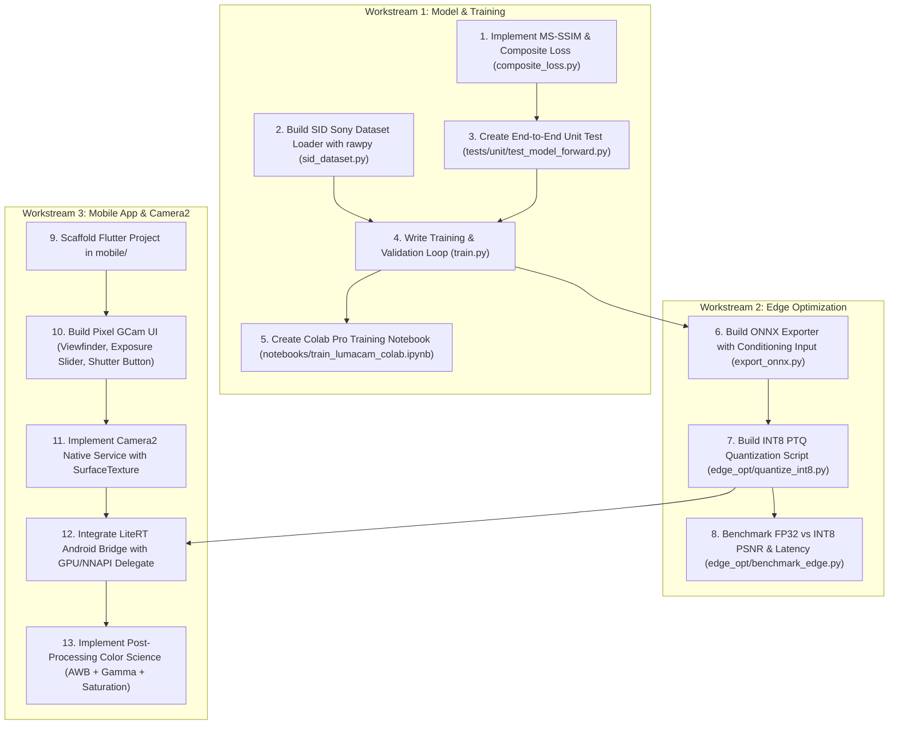

# LumaCam: Project Progress, Architecture State & AI Harness Handoff
> **Repository**: `D:\Development\LumaCam`  
> **Active Git Branch**: `main`  
> **Target Mobile Device**: Google Pixel 7 (Tensor G2, Camera2 Level 3 / RAW_SENSOR, NNAPI/GPU Delegate)  
> **Development Hardware**: Local NVIDIA GTX 1650 (4GB VRAM) for testing + Google AI Pro / Colab Pro for full training  
> **Academic Context**: Final Year Capstone Project — Team 21 (SCTCE, Guided by Asst. Prof. Arya Sreedhar)  
> **Team Members**: Sreelakshmi A (262), Sreenandan S (263), Sreeveni R (264)  
> **Last Updated**: October 2026

---

## 1. Executive Summary & Objective

**LumaCam** is an edge-native, real-time Low-Light Image Enhancement (LLIE) camera mobile application inspired by the Google Pixel GCam interface. It replaces heavy, multi-second diffusion models with an **Exposure-Conditioned Attention U-Net GAN** capable of single-pass inference at near real-time rates (~30 FPS preview target on Pixel 7).

### Key Architectural Pillars:
1. **Raw Bayer Pipeline**: Operating directly on packed 4-channel raw sensor data $(H/2, W/2, 4)$ to preserve 14-bit dynamic range and suppress shot noise before demosaicing.
2. **Exposure Conditioning (FiLM)**: User-controlled exposure slider ($\alpha$) dynamically modulates the bottleneck features using Feature-wise Linear Modulation: $\text{FiLM}(F) = (1 + \gamma(\alpha)) \odot F + \beta(\alpha)$.
3. **Attention Gates (AG)**: Spatial attention gates on skip connections filter out heavy dark-region sensor noise before concatenating with decoder representations.
4. **PatchGAN Discriminator**: A $70 \times 70$ Markovian patch discriminator prevents CNN mean-squared over-smoothing and recovers realistic high-frequency micro-textures.
5. **Edge Optimization**: Post-Training INT8 Quantization (PTQ) deployed via LiteRT (TensorFlow Lite) accelerated by Google Tensor G2 GPU/NNAPI delegates.
6. **Flutter + Camera2 System**: A zero-copy Android `SurfaceTexture` / Flutter `Texture` pipeline providing low-latency viewfinder preview and full-fidelity capture.

---

## 2. Completed Milestones & Code Inventory

The following core modules and project configurations have been implemented and verified:

| File Path | Component | Status | Description |
|---|---|---|---|
| [`AGENTS.md`](AGENTS.md) | AI Agent Guide | ✅ Complete | Complete project specification, team breakdown, and agent guidelines. |
| [`.gitignore`](.gitignore) | Version Control | ✅ Complete | Configured for PyTorch checkpoints, raw datasets (`.ARW`, `.dng`), Flutter, and Android. |
| [`requirements.txt`](requirements.txt) | Environment Spec | ✅ Complete | Python dependencies (PyTorch, rawpy, onnx, lpips, opencv-python, pyyaml, etc.). |
| [`model/datasets/raw_processing.py`](model/datasets/raw_processing.py) | Bayer Pipeline | ✅ Complete | NumPy & PyTorch implementations of Bayer quad packing $(H, W) \rightarrow (H/2, W/2, 4)$, black-level calibration (512 for Sony), normalization, and amplification ratio $\alpha$. |
| [`model/networks/attention_gate.py`](model/networks/attention_gate.py) | Skip Filtering | ✅ Complete | Spatial Attention Gate module (Oktay et al. / Thesia & Suthar) computing soft attention map $\alpha \in [0, 1]$. |
| [`model/networks/conditioning.py`](model/networks/conditioning.py) | Latent FiLM | ✅ Complete | Feature-wise Linear Modulation layer mapping user exposure scalar to scale $(\gamma)$ and shift $(\beta)$ vectors. Zero-initialized for identity pass-through at start. |
| [`model/networks/generator.py`](model/networks/generator.py) | Core Generator | ✅ Complete | Exposure-Conditioned Attention U-Net with 4 downsampling stages, FiLM bottleneck, 4 Attention Gates, and a Sub-Pixel `PixelShuffle(2)` reconstruction head. |
| [`model/networks/discriminator.py`](model/networks/discriminator.py) | Adversarial Patch | ✅ Complete | $70 \times 70$ receptive field Markovian PatchGAN evaluating local texture realism to enforce high-frequency fidelity. |

---

## 3. Immediate Next Steps (Workstream Breakdown)

Incoming AI agents or human developers should pick up tasks in the following sequential order:

---

## 4. Detailed Task Specifications for Upcoming Implementation

### Task 1: Composite Loss Function (`model/losses/composite_loss.py`)
- **Objective**: Implement composite training loss:
  $$\mathcal{L}_{total} = \mathcal{L}_{adv}(G, D) + \lambda_1 \|y - G(x)\|_1 + \lambda_{ms} (1 - \text{MS-SSIM}(y, G(x)))$$
- **Components**:
  - Differentiable Multi-Scale SSIM (`MS-SSIM`) module in PyTorch.
  - Pixel-wise $L_1$ loss.
  - Relativistic or Standard conditional GAN loss (BCEWithLogitsLoss).
- **Hyperparameter defaults**: $\lambda_1 = 100.0$, $\lambda_{ms} = 10.0$, $\lambda_{adv} = 1.0$.

### Task 2: See-in-the-Dark (SID) Dataset Loader (`model/datasets/sid_dataset.py`)
- **Objective**: Load Sony $\alpha$7S II `.ARW` raw pairs from the SID dataset.
- **Processing**:
  - Use `rawpy` to unpack Bayer sensor data.
  - Extract random $512 \times 512$ raw patches (corresponding to $256 \times 256$ in packed 4-channel space).
  - Compute amplification factor $\alpha = \frac{\text{exposure\_time}_{long}}{\text{exposure\_time}_{short}}$.
  - Ground truth $y$: Loaded from long-exposure `.ARW` post-processed to sRGB via `rawpy.postprocess(use_camera_wb=True, half_size=False)`.

### Task 3: Comprehensive Forward Pass Unit Test (`tests/unit/test_model_forward.py`)
- **Objective**: Validate tensor shape transformations from input to output:
  - Input: Dummy raw tensor $(B, 1, 512, 512)$ packed to $(B, 4, 256, 256)$.
  - Conditioning: Scalar exposure tensor $(B, 1)$ passed to FiLM.
  - Generator output: $(B, 3, 512, 512)$ in range $[0, 1]$.
  - Discriminator output: $(B, 1, 61, 61)$ patch logits.
  - Assert no gradient breaks and verify attention map shapes.

### Task 4: ONNX Exporter (`model/export_onnx.py`)
- **Objective**: Export the PyTorch Generator to ONNX format.
- **Signatures**:
  - Inputs: `input_bayer` of shape `[1, 4, H/2, W/2]` and `alpha_exposure` of shape `[1, 1]`.
  - Output: `enhanced_rgb` of shape `[1, 3, H, W]`.
  - Validate with ONNX Runtime using dummy inputs.

### Task 5: LiteRT INT8 Quantization (`edge_opt/quantize_int8.py`)
- **Objective**: Convert ONNX to LiteRT (`.tflite`) with INT8 Post-Training Quantization (PTQ).
- **Representative Calibration Dataset**: Extract 100 representative dark patches from SID to calibrate INT8 scale and zero-point parameters.
- **Target**: Ensure PSNR drop $< 0.5\text{ dB}$ compared to FP32.

### Task 6: Flutter GCam UI & Camera2 Pipeline (`mobile/`)
- **UI Screen**: Minimalist GCam viewfinder, bottom carousel (Night Sight / Adaptive Low Light / Capture), real-time exposure slider (EV -3 to +3 mapped to $\alpha \in [0.5, 3.0]$).
- **Native Android Controller**:
  - Camera2 `ImageReader` capturing preview frames.
  - Background execution thread invoking LiteRT.
  - Zero-copy display via Android `SurfaceTexture` / Flutter `Texture` ID.

---

## 5. Directives for Incoming AI Harnesses

When an AI agent continues working on this repository:
1. **Check this file first**: Review `Progress.md` to see which tasks are marked ✅ Complete and which task is next.
2. **Explain the "Why"**: As outlined in `AGENTS.md`, the 3 students are beginner-to-intermediate learners. Always explain computational photography concepts (e.g., Bayer patterns, black level pedestal, FiLM modulation, sub-pixel convolutions) in code comments and explanations.
3. **Verify Tensor Shapes**: Always assert dimensions at each stage of the U-Net: $(H/2, W/2) \rightarrow (H/4, W/4) \dots \rightarrow (H, W, 3)$.
4. **Update `Progress.md`**: Upon completing each task, update the status table and checklist in this document so context is never lost.
