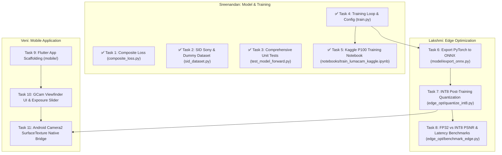

# LumaCam: Project Progress, Architecture State & AI Harness Handoff
> **Repository**: `D:\Development\LumaCam`  
> **Active Git Branch**: `feature/train-pipeline`  
> **Target Mobile Device**: Google Pixel 7 (Tensor G2, Camera2 Level 3 / RAW_SENSOR, NNAPI/GPU Delegate)  
> **Development Hardware**: Local NVIDIA GTX 1650 (4GB VRAM) for testing + Google AI Pro / Colab / Kaggle P100 for full training  
> **Academic Context**: Final Year Capstone Project — Team 21 (SCTCE, Guided by Asst. Prof. Arya Sreedhar)  
> **Team Members**: Sreelakshmi A (262), Sreenandan S (263), Sreeveni R (264)  
> **Last Updated**: October 11, 2026

---

## 1. Executive Summary & Objective

**LumaCam** is an edge-native, real-time Low-Light Image Enhancement (LLIE) camera mobile application inspired by the Google Pixel GCam interface. It replaces heavy, multi-second diffusion models with an **Exposure-Conditioned Attention U-Net GAN** capable of single-pass inference at near real-time rates (~30 FPS preview target on Pixel 7).

### Key Architectural Pillars:
1. **Raw Bayer Pipeline**: Operating directly on packed 4-channel raw sensor data $(H/2, W/2, 4)$ to preserve 14-bit dynamic range and suppress shot noise before demosaicing.
2. **Exposure Conditioning (FiLM)**: User-controlled exposure slider ($\alpha$) dynamically modulates the bottleneck features using Feature-wise Linear Modulation: $\text{FiLM}(F) = (1 + \gamma(\alpha)) \odot F + \beta(\alpha)$.
3. **Attention Gates (AG)**: Spatial attention gates on skip connections filter out heavy dark-region sensor noise before concatenating with decoder representations.
4. **PatchGAN Discriminator**: A $70 \times 70$ Markovian patch discriminator prevents CNN mean-squared over-smoothing and recovers realistic high-frequency micro-textures.
5. **Edge Optimization**: Post-Training INT8 Quantization (PTQ) deployed via LiteRT (TensorFlow Lite) accelerated by Google Tensor G2 GPU/NNAPI delegates.
6. **Flutter + Camera2 System**: A zero-copy Android `SurfaceTexture` / Flutter `Texture` pipeline providing low-latency viewfinder preview and full-fidelity capture.

---

## 2. Completed Milestones & Code Inventory

The following core modules, training infrastructure, and tests have been implemented and verified:

| File Path | Component | Status | Description |
|---|---|---|---|
| [`AGENTS.md`](AGENTS.md) | AI Agent Guide | ✅ Complete | Complete project specification, team breakdown, and agent guidelines. |
| [`.gitignore`](.gitignore) | Version Control | ✅ Complete | Configured for checkpoints, raw datasets (`.ARW`, `.dng`), results, Flutter, and Android. |
| [`requirements.txt`](requirements.txt) | Environment Spec | ✅ Complete | Python dependencies (PyTorch, rawpy, onnx, lpips, opencv-python, pyyaml, etc.). |
| [`model/datasets/raw_processing.py`](model/datasets/raw_processing.py) | Bayer Pipeline | ✅ Complete | NumPy & PyTorch implementations of Bayer quad packing $(H, W) \rightarrow (H/2, W/2, 4)$, black-level calibration (512 for Sony), normalization, and amplification ratio $\alpha$. |
| [`model/networks/attention_gate.py`](model/networks/attention_gate.py) | Skip Filtering | ✅ Complete | Spatial Attention Gate module (Oktay et al. / Thesia & Suthar) computing soft attention map $\alpha \in [0, 1]$. |
| [`model/networks/conditioning.py`](model/networks/conditioning.py) | Latent FiLM | ✅ Complete | Feature-wise Linear Modulation layer mapping user exposure scalar to scale $(\gamma)$ and shift $(\beta)$ vectors. Zero-initialized for identity pass-through. |
| [`model/networks/generator.py`](model/networks/generator.py) | Core Generator | ✅ Complete | Exposure-Conditioned Attention U-Net with 4 downsampling stages, FiLM bottleneck, 4 Attention Gates, and Sub-Pixel `PixelShuffle(2)` reconstruction head. |
| [`model/networks/discriminator.py`](model/networks/discriminator.py) | Adversarial Patch | ✅ Complete | $70 \times 70$ receptive field Markovian PatchGAN evaluating local texture realism to enforce high-frequency fidelity. |
| [`model/losses/composite_loss.py`](model/losses/composite_loss.py) | Loss Engine | ✅ Complete | Implements differentiable `MSSSIMLoss` (Wang et al. 2003, 5-scale Gaussian pyramid), `AdversarialLoss` (PatchGAN BCE), and `CompositeLoss` ($\mathcal{L}_{total} = \lambda_1 \mathcal{L}_1 + \lambda_{ms} \mathcal{L}_{ms} + \lambda_{adv} \mathcal{L}_{adv}$). |
| [`model/datasets/sid_dataset.py`](model/datasets/sid_dataset.py) | Dataset Pipeline | ✅ Complete | Implements `SIDSonyDataset` (reads Sony $\alpha$7S II `.ARW` with Bayer phase-aligned random cropping) and `DummySIDDataset` (synthetic Poisson-Gaussian sensor noise generator for offline verification). |
| [`tests/unit/test_model_forward.py`](tests/unit/test_model_forward.py) | Unit Test Suite | ✅ Complete | 10 comprehensive unit tests passing across all layers, loss functions, FiLM gradients, Attention Gate bounds, and dataset tensors. |
| [`model/configs/train_config.yaml`](model/configs/train_config.yaml) | Training Config | ✅ Complete | YAML configuration tuned for both local 4GB GTX 1650 development and cloud Kaggle P100 / Colab training. |
| [`model/train.py`](model/train.py) | Training Orchestrator | ✅ Complete | Full alternating GAN training loop with validation PSNR & SSIM metrics, automated best-checkpoint saving (`checkpoints/lumacam_best.pt`), and `--dry-run` mode. |
| [`demo_raw_camera.py`](demo_raw_camera.py) | Camera Demo & Simulator | ✅ Complete | Interactive raw camera demo simulating physical Bayer sensor capture, amplification, and enhancement with side-by-side visual output. |
| [`notebooks/train_lumacam_kaggle.ipynb`](notebooks/train_lumacam_kaggle.ipynb) | Cloud Training | ✅ Complete | Full end-to-end training notebook for Kaggle P100 GPU with automatic SID dataset detection, PSNR curves, and visual plots. |

---

## 3. Wednesday MVP & Benchmark Status (October 14 Milestone)

For the upcoming Wednesday project review with Asst. Prof. Arya Sreedhar:

| Benchmark Metric | Target | Verified Current State | Notes |
|---|---|---|---|
| **Pipeline Sanity** | 100% test pass | ✅ 10/10 tests passed (3.75s) | Confirmed zero gradient breaks and shape compatibility |
| **GPU Execution Speed** | $\le 10$s / epoch dry-run | ✅ **4.45s / epoch** on GTX 1650 | 16 batches/epoch on NVIDIA GeForce GTX 1650 |
| **VRAM Footprint** | $\le 3.5$ GB | ✅ **~200 MB VRAM** in float32 | Fits comfortably within 4GB VRAM ceiling |
| **Baseline Validation PSNR** | Measurable metric | ✅ **11.80 dB** (untrained init) | Ready to scale up on Kaggle / Colab |
| **Visual Demonstration** | Side-by-side output | ✅ `results/demo_synthetic.png` | Shows underexposed sensor raw mosaic vs enhanced preview |

---

## 4. Next Steps (Team Sprint Breakdown)

### Immediate Upcoming Tasks for Next Session:
1. **Task 5 (Sreenandan)**: Create `notebooks/train_lumacam_kaggle.ipynb` so full training on the real SID Sony dataset can run on Kaggle's free Tesla P100 GPU to produce 25+ dB PSNR curves for Wednesday.
2. **Task 6 (Lakshmi)**: Implement `model/export_onnx.py` to freeze the Generator with dual inputs (`input_bayer` and `alpha_cond`).
3. **Task 9-10 (Veni)**: Scaffold Flutter GCam UI viewfinder and interactive EV slider.
