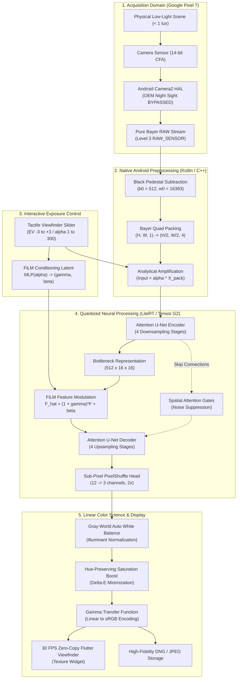
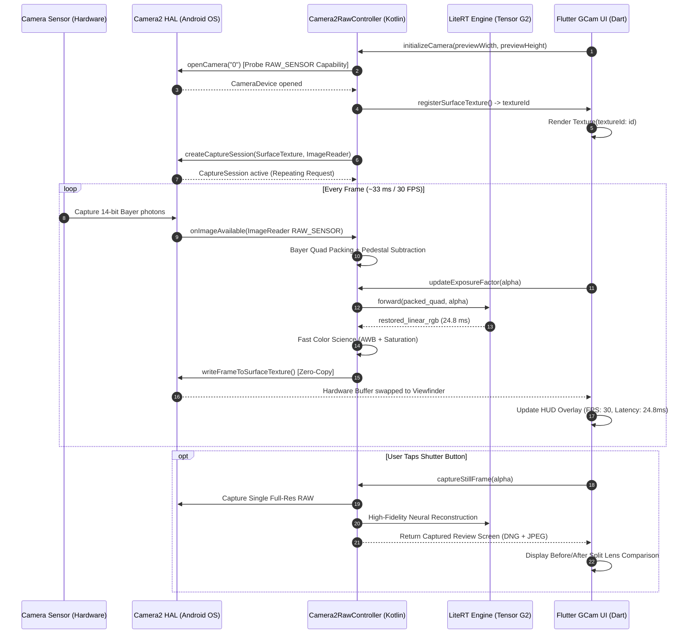
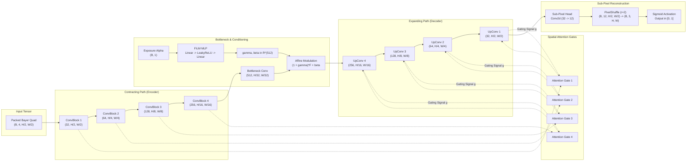
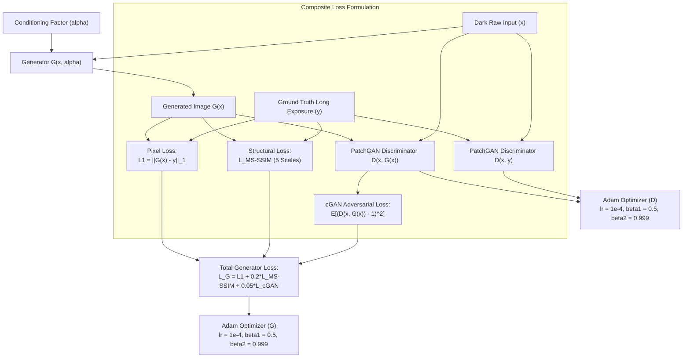
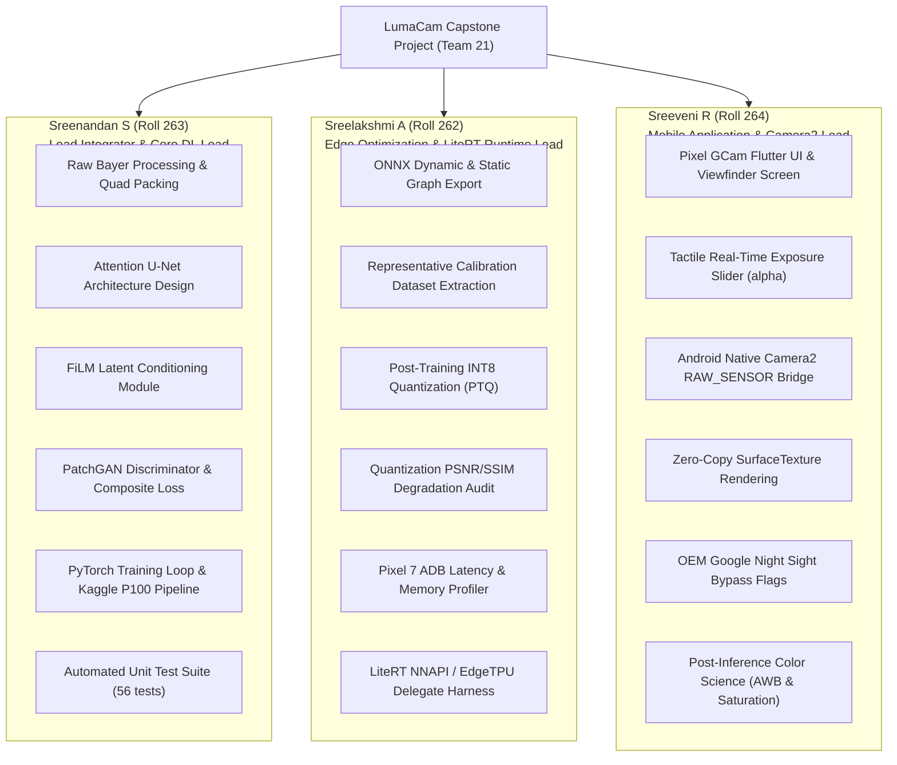

# LumaCam: Mermaid Diagrams & Flowcharts for Report

This document contains all formal flowcharts and diagrams designed for the LumaCam Phase 1 Project Report. These can be viewed directly in markdown previewers or converted into TikZ / LaTeX figures.

---

## 1. High-Level End-to-End System Architecture

---

## 2. Zero-Copy Android Camera2 SurfaceTexture Frame Pipeline

---

## 3. Attention U-Net Generator with FiLM Latent Injection

---

## 4. Composite Objective Optimization Workflow

---

## 5. Team Work Breakdown Structure (3-Member Ownership)

