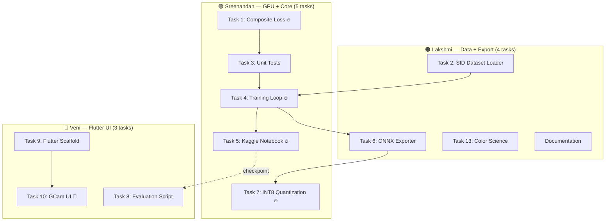

# LumaCam: 2-Week Sprint — Team Task Division & Git Workflow (v3 Final)

## Goal Description

Optimized task split for a **2-week deadline** where:
- **Sreenandan** → only GPU owner → **compute-heavy, architecturally complex** tasks
- **Veni & Lakshmi** → no GPU → **well-scoped tasks doable with Claude Code / AI agents**

| Member | Alias | Tasks | Tools |
|---|---|---|---|
| **Sreenandan S (263)** | **Me** | 5 tasks — Composite Loss, Unit Tests, Training Loop, Kaggle Notebook, INT8 Quantization | GTX 1650 + Kaggle GPU |
| **Sreeveni R (264)** | **Veni** | 3 tasks — Flutter Scaffold, GCam UI, Evaluation Script | Claude Code |
| **Sreelakshmi A (262)** | **Lakshmi** | 4 tasks — SID Dataset Loader, ONNX Export, Color Science, Documentation | Claude Code |

> [!NOTE]
> Each member has a dedicated handoff document with full AI-agent-ready specs:
> - [`me.md`](file:///C:/Users/imsre/.gemini/antigravity-cli/brain/7e92771b-8eeb-4d1b-8e95-dee215f0e6cc/me.md) — Sreenandan's tasks
> - [`veni.md`](file:///C:/Users/imsre/.gemini/antigravity-cli/brain/7e92771b-8eeb-4d1b-8e95-dee215f0e6cc/veni.md) — Veni's tasks
> - [`lakshmi.md`](file:///C:/Users/imsre/.gemini/antigravity-cli/brain/7e92771b-8eeb-4d1b-8e95-dee215f0e6cc/lakshmi.md) — Lakshmi's tasks

---

## Assignment Overview



---

## 2-Week Timeline

| Day | 🟢 Sreenandan | 🔵 Veni | 🟠 Lakshmi |
|---|---|---|---|
| **1-2** | Create branches. Implement `composite_loss.py`. | Clone repo. `flutter create` scaffold. | Clone repo. Parse SID text file, implement `__init__`. |
| **3-4** | Write `test_model_forward.py`. Verify on GPU. | Build viewfinder + exposure slider. | Implement `__getitem__` + `DummySIDDataset`. |
| **5-6** | Start `train.py` + config YAML. **Review PRs.** | Shutter button + mode carousel. Push PR. | Push PR. Start ONNX exporter. |
| **7** | **Merge PRs → `dev`**. Test training locally (1-2 epochs). | Fix review comments. | Fix review comments. |
| **8-9** | Kaggle notebook. Start full training. | Start `evaluate.py`. | Complete ONNX export. Start color science. |
| **10-11** | Monitor training. Start `quantize_int8.py`. | Complete evaluate.py. Widget tests. | Complete color science. Update docs. |
| **12-13** | Finish quantization. Benchmark PSNR. | UI polish. Push evaluate PR. | Push color science PR. Phase 2 docs. |
| **14** | **Final merge → `main`. Tag `v0.2.0-alpha`.** | Final cleanup. | Final cleanup. |

---

## Git Branch Map

```
main ──→ dev ──→ feature/train-pipeline      (Sreenandan: loss, tests, train, quantization)
              ──→ feature/app-flutter-ui      (Veni: scaffold, UI, evaluate)
              ──→ feature/dataset-sid         (Lakshmi: dataset, ONNX, color science)
```

### Setup Commands (Sreenandan runs Day 1)

```powershell
git checkout main && git pull origin main
git checkout -b dev && git push -u origin dev

git checkout dev && git checkout -b feature/train-pipeline && git push -u origin feature/train-pipeline
git checkout dev && git checkout -b feature/app-flutter-ui && git push -u origin feature/app-flutter-ui
git checkout dev && git checkout -b feature/dataset-sid && git push -u origin feature/dataset-sid

git checkout feature/train-pipeline
```

### File Ownership

| Files | Owner | Branch |
|---|---|---|
| `model/losses/` | **Sreenandan** | `feature/train-pipeline` |
| `tests/unit/` | **Sreenandan** | `feature/train-pipeline` |
| `model/train.py`, `model/configs/` | **Sreenandan** | `feature/train-pipeline` |
| `edge_opt/quantize_int8.py` | **Sreenandan** | `feature/train-pipeline` |
| `notebooks/` | **Sreenandan** | `feature/train-pipeline` |
| `mobile/` (everything) | **Veni** | `feature/app-flutter-ui` |
| `model/evaluate.py` | **Veni** | `feature/app-flutter-ui` |
| `model/datasets/sid_dataset.py`, `__init__.py` | **Lakshmi** | `feature/dataset-sid` |
| `model/export_onnx.py` | **Lakshmi** | `feature/dataset-sid` |
| `model/postprocess/` | **Lakshmi** | `feature/dataset-sid` |
| `docs/` | **Lakshmi** | `feature/dataset-sid` |
